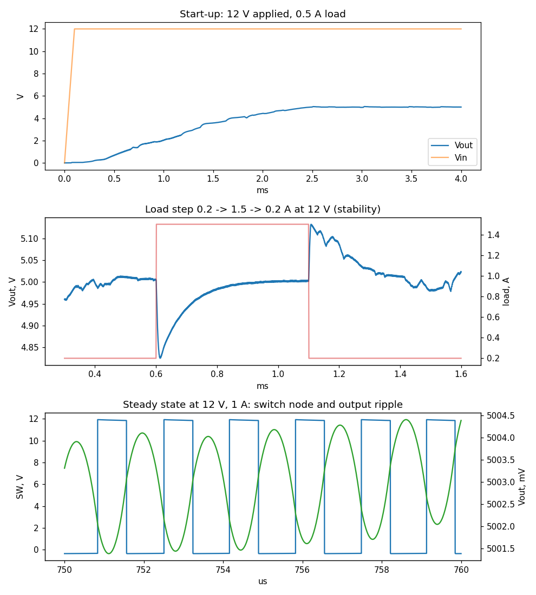
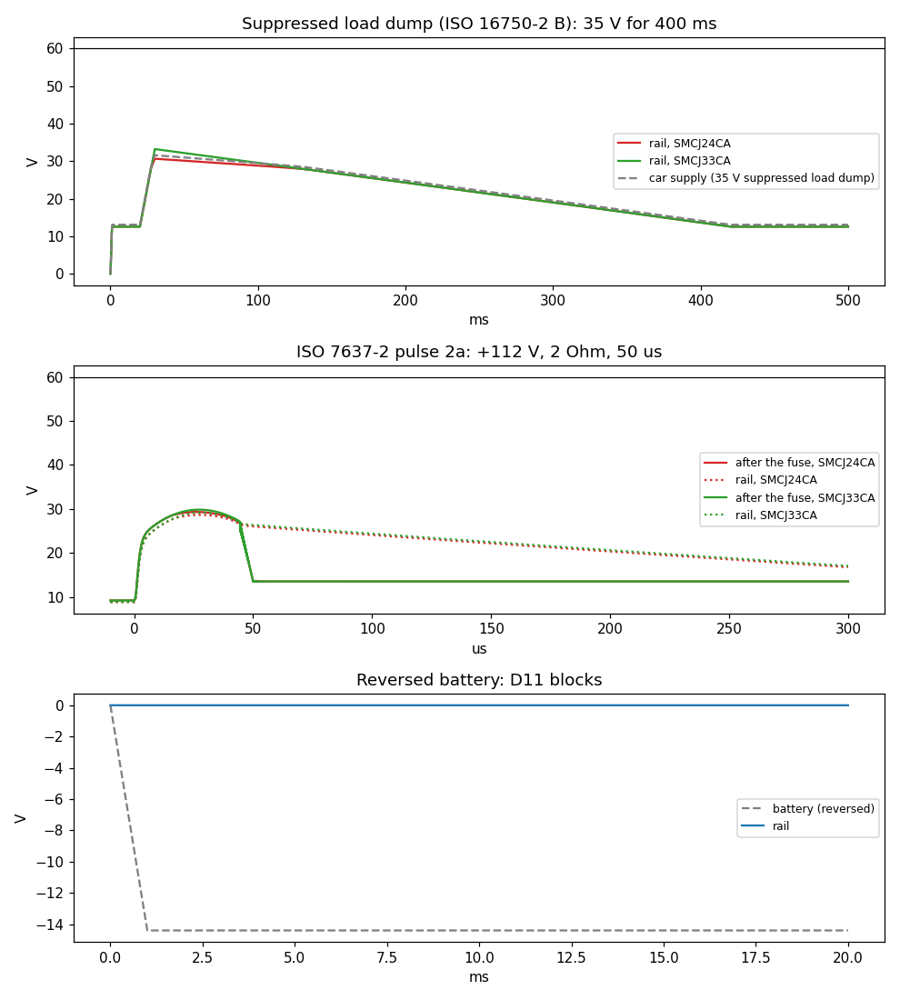
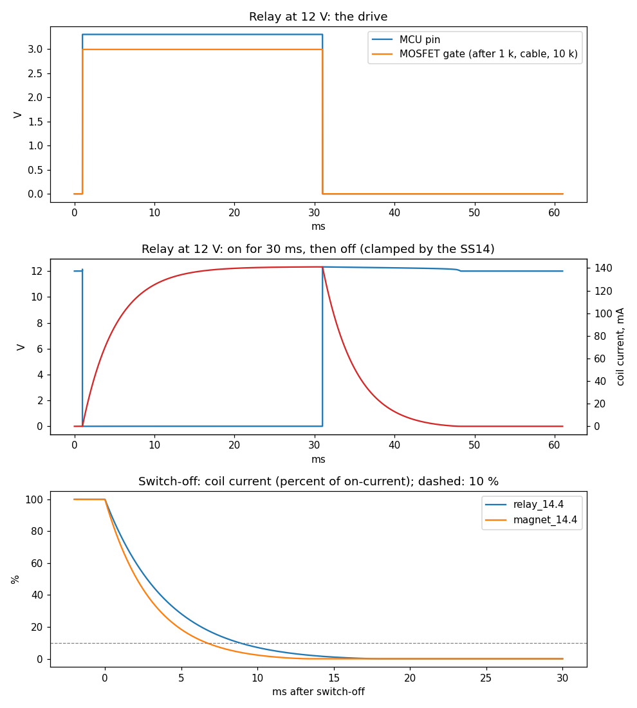
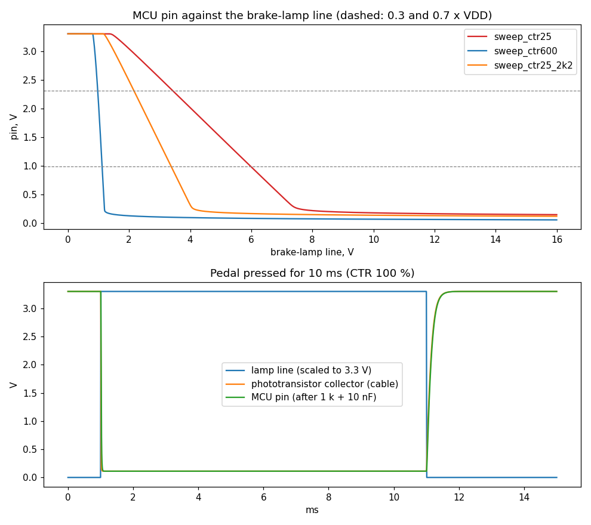
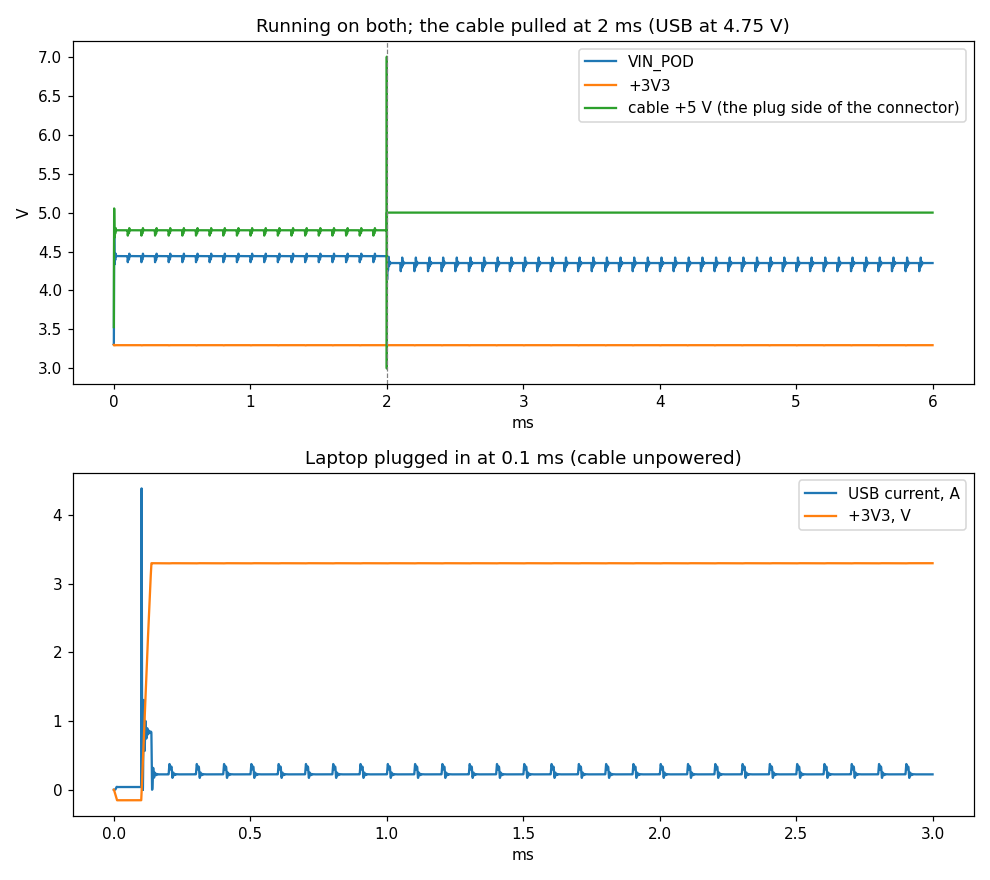

# 9. Testing and Validation

## 9.1 Circuit simulation of the hub boards

Before the boards were ordered, each power and interface circuit on them was simulated with its
exact component values, to check the design (values, stability, ratings) rather than the layout.
The simulations ran in ngspice, the SPICE simulator built into KiCad, in its PSpice-compatible
mode so that manufacturers' models could be used. Texas Instruments' own transient model was used
for the 5 V converter. No SPICE model is published for the AO3400A MOSFET, the SS14 and B560C
diodes, the TVS diodes, the PC817 optocoupler or the AP2112K regulator, so those were modelled from
their datasheet figures. Each case was judged automatically against a stated limit, and every
script fails if any limit is missed (`hardware/sim/`, `run_*.sh`). Track inductance, switch-node
ringing and noise depend on the real board and are checked at bring-up.

Three simulations changed the design before ordering:
- the TVS diode became an SMCJ33CA instead of an SMCJ24CA (Figure 9.2);
- R63 became 4.7 kΩ instead of 2.2 kΩ (Figure 9.4);
- the pod's C1 and C2 became 1 µF and 4.7 µF instead of 10 µF each (Figure 9.5).

All three were value changes in the same footprints, so the routed copper did not change.

### 9.1.1 The 5 V converter (power board)

The TPS54360 buck converter, built to TI's 5 V reference design, was simulated starting up,
under a load step, and across the car's input range (Figure 9.1). All checks passed:
- it reaches 4.75 V in 2.26 ms with 0.9 % overshoot (limit 3 %);
- a 0.2 → 1.5 A step moves the output by 179 mV (3.6 %; limit 5 %), and the output is back
  within 1 % in 123 µs, without ringing, which shows the control loop is stable;
- from 9 V to 30 V in, the output holds at 5.00 V with 7–35 mV of ripple (limit 50 mV) at
  602 kHz.

*Figure 9.1: The power board's 5 V converter (TPS54360, TI's transient model). Top: start-up
from 12 V with a 0.5 A load. Middle: load step 0.2 → 1.5 → 0.2 A at 12 V. Bottom: steady state
at 12 V and 1 A, the switch node and the output ripple (millivolts).*

### 9.1.2 The 12 V input protection (power board)

The input chain (a 3 A fuse, a bidirectional TVS diode, a B560C reverse-polarity diode and the
47 µF input capacitor), loaded by the converter, the LiDAR and all five relay coils, was
subjected to the disturbances of ISO 16750-2 and ISO 7637-2 for a 12 V car (Figure 9.2). In
every case the rail stayed between −1 V and the converter's 60 V rating:
- a reversed battery leaves the rail at 0 V;
- a 24 V jump-start passes through, with the TVS idle;
- pulse 1 (−150 V) is absorbed by the TVS and blocked by the diode;
- pulse 2a (+112 V) is absorbed by the input capacitor, with the rail at most 29 V.

The suppressed load dump (35 V for 400 ms) found a weakness in the TVS first chosen. The
SMCJ24CA breaks down at about 27 V, so it tried to hold the whole car's supply down, dissipating
up to 141 W for about 100 ms against roughly 152 W allowed. The SMCJ33CA breaks down at about
37 V: it stays idle through that dump (the rail reaches 33.2 V) and still clamps the fast
spikes. It was adopted.

*Figure 9.2: The 12 V input protection. Top: the suppressed load dump (ISO 16750-2 test B), with
the SMCJ24CA first chosen and the SMCJ33CA fitted. Middle: ISO 7637-2 pulse 2a. Bottom: a
reversed battery, blocked by D11.*

### 9.1.3 The relay and magnet drivers (pod to power board)

The full drive path was simulated (Figure 9.3): the pod's microcontroller pin, its 1 kΩ
resistor, the DB-25 cable, the power board's 10 kΩ pull-down, the AO3400A MOSFET, and the coil
with its SS14 flyback diode. The coils use typical values until the parts are bought: relay
85 Ω / 0.35 H, magnet 48 Ω / 0.15 H. All checks passed:
- the gate reaches 2.99 V (needs 2.5 V);
- the MOSFET drops 3–9 mV when on;
- the turn-off spike is clamped to the supply plus 0.3 V (at most 14.8 V, against a 30 V
  rating);
- the diode carries at most 307 mA, against a 1 A rating;
- with the pod unplugged, the gate stays at 0 V and the coil stays off.

The magnet lets go 6.6 ms after switch-off (its current down to 10 %), and a relay 8.5–8.8 ms
after.

*Figure 9.3: The relay and magnet drivers. Top: the microcontroller pin and the MOSFET gate at
the far end of the cable. Middle: a relay on for 30 ms at 12 V, its low side and coil current.
Bottom: coil current after switch-off for a relay and the cable magnet; dashed, 10 %.*

### 9.1.4 The brake-light input (power board to pod)

The brake-lamp line was simulated as it reaches the microcontroller (Figure 9.4): through R63
and the PC817 optocoupler (with D21 against reversal), up the cable, then the pod's 10 kΩ
pull-up and 1 kΩ + 10 nF filter. The PC817 was tested at both ends of its range:
- the weakest: CTR 25 %, the datasheet's 50 % minimum halved for heat, ageing and low current;
- the strongest: CTR 600 %, the datasheet's maximum.

All checks passed:
- with the weakest part, the pin reads "pressed" (0.20 V) at 9 V, and from 6 V upwards;
- with the strongest part, it reads "released" with 0.5 V on the line;
- wiring connected the wrong way round is absorbed by D21;
- the pin follows the pedal within 0.2 ms.

R63 was first 2.2 kΩ. It dissipated 237 mW during a 60 s, 24 V jump-start, beyond an 0805
resistor's 125 mW, so it became 4.7 kΩ: 111 mW. One limit remains, noted for the next board
revision. The input's threshold is the LED's forward voltage, about 1 V for a strong part, so a
lamp-check voltage on a dark brake-lamp line would read as "pressed". This errs on the safe
side: the system yields to the driver.

*Figure 9.4: The brake-light input. Top: the microcontroller pin against the brake-lamp line
voltage, for the weakest and strongest PC817 with R63 = 4.7 kΩ, and the weakest with the 2.2 kΩ
first fitted; dashed, the pin's logic thresholds (0.3 and 0.7 × VDD). Bottom: the pedal pressed
for 10 ms.*

### 9.1.5 The pod's supply

The pod runs from two sources, joined through two Schottky diodes onto the AP2112K 3.3 V
regulator: +5 V from the power box through the polyfuse and the cable, and USB from the laptop
(Figure 9.5). It was simulated at the full current budget, about 240 mA, including the gesture
sensor's 100 mA LED pulses. The 3.3 V rail held at 3.29 V in every case:
- on the worst cable path (the polyfuse at its 1 Ω maximum and 3 m of 26 AWG);
- on USB alone at its lowest allowed 4.40 V;
- on both sources together;
- when the cable was pulled while running.

With the cable powered and the laptop asleep, 0.2 µA flows back into the laptop's USB port.

The first values failed one check. With 10 µF for both C1 and C2, the pod presented about 22 µF
to the USB port and drew 88 µC when plugged in, against USB 2.0's 50 µC (10 µF) limit. At
1 µF and 4.7 µF (the regulator needs 1 µF on each side) it draws 28 µC, and these values were
adopted.

*Figure 9.5: The pod's supply. Top: running on both sources, with the inter-box cable pulled at
2 ms (USB at 4.75 V); the 3.3 V rail does not move. Bottom: the laptop plugged into an unpowered
pod, the inrush current and the 3.3 V rail.*

## 9.2 Software tests

[RESULT: the final unit, integration, firmware and replay-harness counts (as of 2026-10-08:
host unit 289/289, integration 52/52, Python 8/8, firmware 38/38, harness 22/22)]

## 9.3 Actuator bench test (Part 13.3)

[RESULT: the bench gate: force ceiling, driver override at maximum intensity (3/3, video),
watchdog release time measured by the hub, cable pulled mid-brake]

## 9.4 Staged real-world validation (Part 13.4, stages A–D)

[RESULT: event-log extracts per stage: timestamps, TTC values, applied intensity, release reasons]
