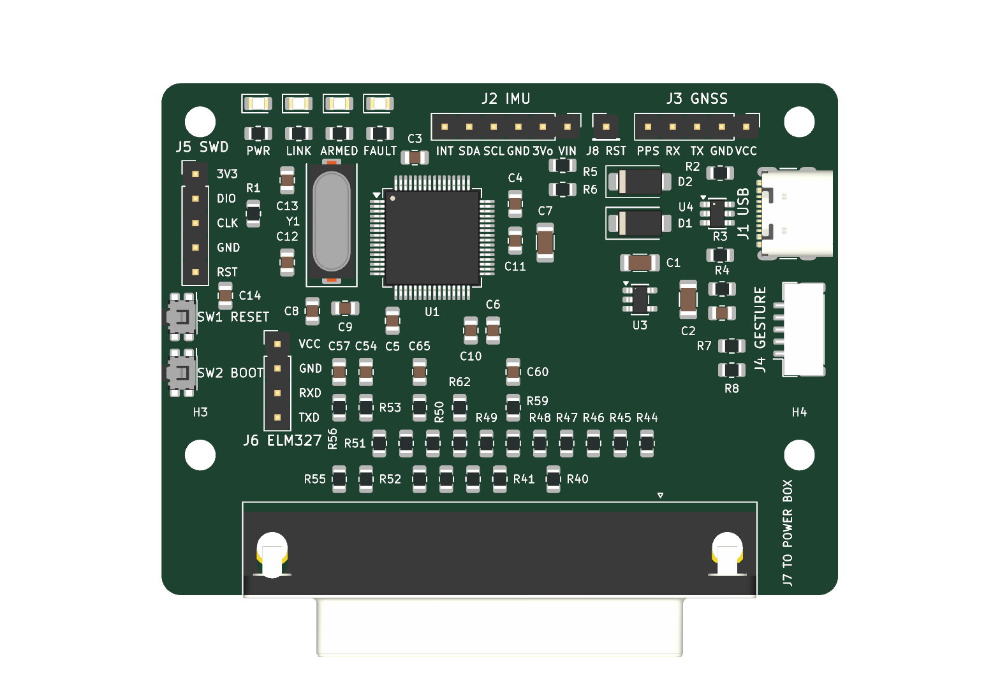
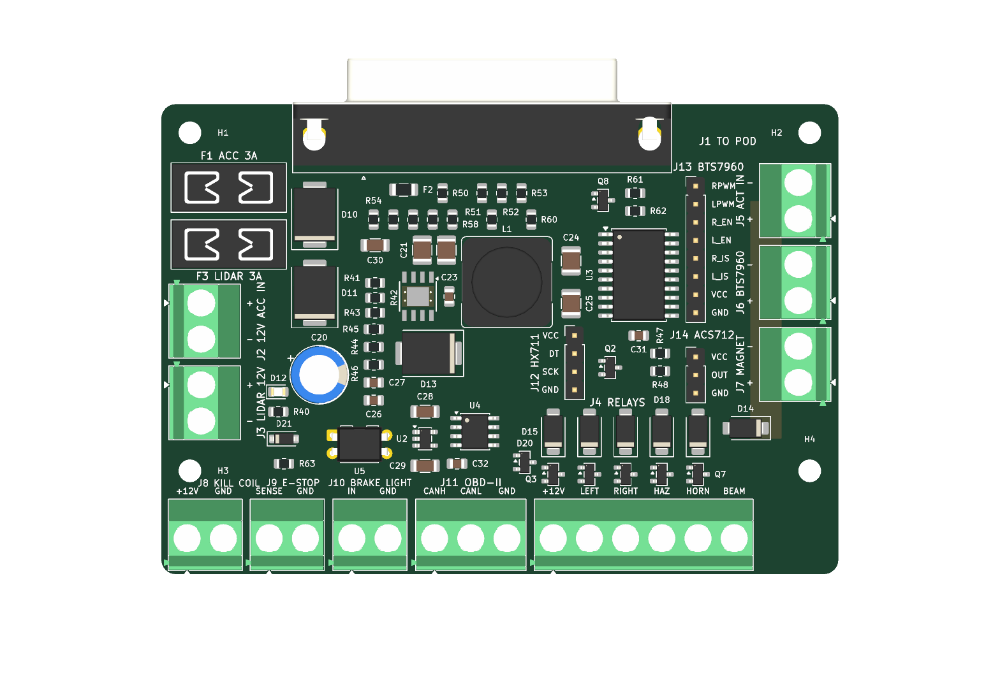

# PCB layout guide: the pod board and the power board

**For someone who has never laid out a PCB.** Both boards are **placed and routed**: every part
is on the board in a checked position, every connection is drawn in copper, and KiCad's own
checker finds no error. What is left for you is **reviewing** the result (so you can explain and
defend every track), a short finishing pass, and ordering. This guide explains the ideas first
(Part A), then the placement (Part C), then how the routing was made and what to look at in it
(Parts D to F).

| What | Where |
|---|---|
| The boards, placed and routed | `hardware/pod_board/pod_board.kicad_pro`, `hardware/power_board/power_board.kicad_pro` |
| Every part's position and the reason for it | `hardware/pod_board/placement.md`, `hardware/power_board/placement.md` |
| A 3D picture of each board | `hardware/*/placement.png` (placed), `hardware/*/routed.png` (routed) |
| The rules (track widths, clearances) | already in each project (Board Setup); source `hardware/gen/pcb_rules.py` |
| The schematics (what connects to what) | `hardware/*/<board>.pdf` |
| How the parts were placed (re-runnable) | `hardware/gen/placement.py`, `hardware/gen/layout.sh` |
| How the boards were routed (re-runnable) | `hardware/gen/route.py`, `hardware/gen/route.sh` |
| The fabrication files (gerbers, drill, BOM, positions) | `hardware/<board>/fab/`, made by `hardware/gen/finish.sh` |
| The specification checks the DRC cannot make | `hardware/gen/routespec.sh` |

State on 2026-10-09, checked by KiCad's own Design Rules Checker with the schematic-parity check:

| Board | Parts | Connections | Unconnected | DRC errors | Matches schematic |
|---|---|---|---|---|---|
| Pod (70 × 53 mm, 4 layers) | 77 | 172 | 0 | 0 | yes, exactly |
| Power (95 × 66 mm, 2 layers, 2 oz) | 82 | 160 | 0 | 0 | yes, exactly |

The only DRC warnings left are on the power board: the terminal blocks' outlines reach the board
edge (on purpose: their wire openings are flush with it). The pod has none. `hardware/gen/routespec.sh` checks the specification points the DRC does not
know (Part D4).

---

## Part A. The ideas, from zero

### A1. What a PCB is

A printed circuit board is a sandwich: **copper** layers separated by **fibreglass** (FR-4), with
holes drilled through. Your design tells the factory where to leave copper and where to drill.

- **Layers.** The pod board has **4 copper layers**: top (F.Cu, "front"), two inner (In1.Cu,
  In2.Cu), bottom (B.Cu). The power board has **2**: top and bottom.
- **Solder mask** is the green coat over the copper. It is left off ("opened") only over the
  **pads**, the places parts are soldered. It stops solder bridging between tracks.
- **Silkscreen** is the white printing: part names (R12, U1), outlines, polarity marks.
- **Copper weight.** 1 oz/ft² = 35 µm thick (the pod board); 2 oz = 70 µm (the power board,
  because it carries amps: twice the copper carries the same current in half the width).
- **Finish.** The exposed pads are coated so they solder well: HASL (solder-dipped, cheapest)
  or ENIG (gold, flatter). Either works for these boards.

### A2. Parts on the board: footprints

Every schematic symbol has a **footprint**: the pattern of pads the real part solders to.
- **SMD** (surface-mount) pads are on the top surface only: resistors, capacitors, ICs.
  Sizes here: **0805** resistors and capacitors (2.0 × 1.25 mm), comfortable to hand-solder.
- **THT** (through-hole) pads are drilled through the board: connectors, the terminal blocks,
  the DB-25, headers. They connect to every copper layer they pass through.
- The **courtyard** is a box around a footprint that must not overlap another's. KiCad checks it.
  The placement you have has no overlaps.
- **Pin 1** is marked on the silkscreen (a dot, a notch, a square pad). Getting an IC the wrong way
  round is the classic first-board mistake; the footprints all mark it.

### A3. Connections: nets, ratsnest, tracks, vias, zones

- A **net** is everything that must be electrically connected (e.g. `+3V3`, `GND`, `/CAN_TX`).
  The nets come from the schematic.
- The thin straight lines between pads in KiCad are the **ratsnest** ("airwires"): connections
  still to be made. Routing is turning every airwire into copper. When none are left, you are done.
- A **track** (trace) is a strip of copper on one layer joining pads.
- A **via** is a small plated hole that joins a track on one layer to one on another.
- A **zone** (pour, plane) is a filled area of copper connected to one net. A whole layer of `GND`
  is a **ground plane**. Zones connect to pads of their net automatically when "filled".
- **Thermal reliefs** are the little spokes that join a pad to a zone, so the pad can still be
  soldered (a pad merged into a big copper area takes the soldering iron's heat away).

### A4. Width, clearance, and why ground matters

- **Clearance** is the minimum gap between copper of different nets. Ours: 0.2 mm (pod),
  0.25 mm (power board). The fab can do 0.127 mm; we keep a margin.
- **Track width** sets how much current a track carries before it heats up. From IPC-2221
  (the standard chart, outer layer, 10 °C rise), computed in `hardware/gen/pcb_rules.py`:

| Board | Net class | Nets | Current | Needed | Used |
|---|---|---|---|---|---|
| Pod | Default | signals | mA | — | 0.20 mm |
| Pod | Power | VIN_POD, VBUS, X_5V_CABLE | 0.6 A | 0.15 mm | 0.40 mm |
| Pod | Plane3V3 | +3V3 (the In2 plane: a via per pad; the MCU's pins tied to their capacitors) | 0.6 A | 0.15 mm | 0.30 mm |
| Pod | Ground | GND (the In1 plane: a via per pad, not routed) | — | — | 0.25 mm stubs |
| Pod | USB | USB_DP, USB_DM | — | — | 0.20 mm, routed as a pair |
| Power | Default | signals | mA | — | 0.30 mm |
| Power | Supply | ACC_IN, ACC_FUSED, +12V, LIDAR_12V, +5V, BUCK_SW, MAG_NEG | 3 A | 0.68 mm (2 oz) | 1.0 mm |
| Power | Pod5V | 5V_POD (after the pod's 500 mA polyfuse F2) | 0.5 A | 0.06 mm | 0.5 mm |
| Power | Coil | COIL_* | 0.3 A | 0.03 mm | 0.5 mm |
| Power | Ground | GND (the bottom plane and top pour: a via per pad, not routed) | — | — | 0.5 mm stubs |
| Power | Actuator | ACT_12V | 10 A (its fuse) | 3.6 mm (2 oz) | 4.0 mm, or a filled zone |

  These are set as **net classes**, so when you route a net KiCad starts at the right width by
  itself. (File → Board Setup → Net Classes shows them.)
- **Every current flows in a loop.** What goes out on a track comes back on ground, and it takes
  the path right underneath its track if it can. An unbroken ground plane under the signals
  gives every signal a short return path: less noise sent and received, and less trouble. This
  is why the pod board has a whole inner layer of ground (In1), and why you avoid cutting the
  power board's bottom ground with long tracks.

### A5. The checks

- **DRC** (Design Rules Check, Inspect → Design Rules Checker): clearances, widths, overlaps,
  unrouted connections. **Zero errors before ordering, no exceptions.**
- **Schematic parity** (a tick-box in the DRC dialog): the board's connections equal the
  schematic's. Already exact; keep it that way by never adding a connection the schematic lacks.

---

## Part B. Set up (once)

1. Open `hardware/pod_board/pod_board.kicad_pro` in KiCad 10, then the **PCB Editor**.
2. Look around: the board outline, the parts, and the airwires. Press **Alt+3** for the 3D view.
3. **File → Board Setup**:
   - *Board Stackup*: 4 layers (pod), 2 (power); thickness 1.6 mm. Already set.
   - *Constraints*: the fab limits (already set; leave them).
   - *Net Classes*: the table in A4 (already set).
4. The **Layers** panel (right side): click a layer name to make it the active one; the eye hides
   it. Useful: hide **In1.Cu / In2.Cu** while routing the pod board's outer layers (they are solid
   planes and hide everything else).
5. The parts with fixed positions are **locked** (connectors, mounting holes): the enclosures
   depend on them. The rest you may nudge if routing needs it (select, **M** to move, **R** to
   rotate), but keep each part near where it is: its position has a reason (`placement.md`).

**Keys you will use all the time:**

| Key | Does |
|---|---|
| **X** | route a single track from the pad or airwire under the cursor |
| **6** | route a differential pair (USB) |
| **V** | while routing: drop a via and continue on the other layer |
| **W** / **Shift+W** | while routing: next / previous track width |
| **/** | while routing: switch the corner style (45° arcs/lines) |
| **Esc** | finish the track |
| **Delete** / **Backspace** | delete the track segment / the whole track |
| **`** (backtick) | highlight a net |
| **B** / **Ctrl+B** | fill / unfill all zones |
| **Alt+3** | 3D viewer |
| **Ctrl+Z** | undo (generously) |

**Before you change anything:** the boards were generated by `hardware/gen/layout.sh` (placement)
and `hardware/gen/route.sh` (routing). A placement change goes in `placement.py`, then `route.sh`
routes again from scratch. If you instead edit the routed board by hand, **never run `layout.sh
--force` or `route.sh` again** on it: they rebuild the board and would discard your edits.

---

## Part C. The placement you have, and why

Read this with `placement.png` open beside it. Positions are measured from the board's top-left
corner (KiCad's y axis points down).

### C1. Pod board (70 × 53 mm)

| Area | Parts | Why there |
|---|---|---|
| Bottom edge | **J7** DB-25 | the enclosure's cut-out; its housing overhangs the edge by design |
| Behind the DB-25 | R40–R66, C54–C65 in 4 rows | each line's series resistor / pull-up / filter stands **in line with its own DB-25 pin**: the cable tracks run straight up, side by side, without crossing |
| Centre | **U1** STM32F405 | everything fans out to it |
| Around U1 | C3–C11 | each decoupling capacitor **at the supply pin it serves**; C10, C11 at the VCAP pins 31 and 47 (C10 and C6 1 mm further down than first placed, so pin 32 has room for its via) |
| Left of U1 | **Y1** crystal, C12, C13 | within 5 mm of the oscillator pins 5–6 |
| Top-left | R1 | the BOOT0 pull-down |
| Top edge | D3–D6 + R30–R33 | the status LEDs face the driver |
| Right of U1 | D1, D2, C1, U3, C2 | the 5 V → 3.3 V supply, next to the USB |
| Right edge | **J1** USB-C, U4, R2–R4, C15 | the ESD chip right at the socket |
| Right edge, lower | **J4** gesture cable, R7, R8 | |
| Top edge, right | **J3** GNSS cable header | the antenna lead runs up to the pod's roof face |
| Top edge, middle | **J2** IMU header, R5, R6 below it, **J8** (IMU reset) beside it | the IMU breakout plugs into J2 and stands above the top-middle area |
| Left edge | **J5** SWD, then **SW1** RESET and **SW2** BOOT, C14 | every programming control on one edge: the buttons are side-push (Panasonic EVQ-P7C), their plungers flush with the edge, pressed through pin-holes in the enclosure wall (recessed, so not by accident) |
| Left, inboard | **J6** ELM327 | an internal lead to the module inside the pod; its VCC is the pod's 5 V (the HC-05 needs 3.6–6 V) |
| Holes | top corners; the bottom two up beside the DB-25 band | so the DB-25 can span the bottom edge |

The rows behind the DB-25 stand 5 mm below the MCU on purpose: with 3.4 mm the ~20 cable signals
could not all get out from under the MCU on the two outer layers (the routability check failed);
with 5.4 mm they do.

### C2. Power board (95 × 66 mm)

| Area | Parts | Why there |
|---|---|---|
| Top edge | **J1** DB-25 | through the box's front wall |
| Behind the DB-25 | R50–R60 in 2 rows | the fail-safe pull-downs **where each line enters the board**, each in line with its pin |
| Top-left | **F1**, **F3** fuses | reachable with the lid off |
| Left edge | **J2** 12 V in, **J3** LiDAR 12 V | input power side, near their fuses |
| Left-middle | D10 TVS, D11, C20 | the protection straight after the fuse |
| Centre | **U1** TPS54360, C21–C27, D13, **L1**, R41–R46 | the 5 V converter as one tight block (D1) |
| Right edge | **J5**, **J6**, **J7** | the actuator rail: kill relay in, BTS7960 out, magnet; side by side so the 10 A path is ~12 mm. The board is 5 mm wider than the 90 mm it was compacted to, for these terminals' and the module headers' names |
| Right, inboard | **J13**, **J14**, U3 74HCT244, Q2, R47, R48 | the module headers and their buffer, beside the actuator terminals |
| Right edge, below J7 | D14 | the magnet's flyback diode right at the magnet terminal: its cathode on the actuator-rail zone, its anode facing inboard (clear of the rail) for MAG_NEG |
| Top-right | Q8, R61, R62 | the presence detector by DB-25 pin 13 |
| Bottom edge | **J8–J11**, **J4** | everything wired to the car |
| Above J4 | Q3–Q7, D15–D19 | each relay's MOSFET and flyback diode one terminal pitch left of its J4 terminal (J4 pin 1, the coils' common +12 V, needs none), so the right end stays free for D14 |
| Above J11 | U4 SN65HVD230, D20, U2, C28, C29, C32 | the CAN transceiver at the OBD lead: the stub on the car's bus is the lead only; C32 beside U4's VCC pin 3 |
| Left, lower | U5 PC817, R63, D21 | the brake-light input above its terminal |
| Centre-right | J12 | the bench header, beside the converter's output capacitors |
| Holes | top corners; the bottom two up beside the bottom terminal row | so the terminals run corner to corner |

**Which way the terminals face:** every screw terminal's **wire openings face out, over the board
edge**, with the screws on top: a wire goes straight in through the box wall's gland side without
crossing the board, and the screws are reached from above with the lid off. (The first placement
had them facing in; the 3D view showed it. They were turned 180° with their bodies kept in place;
the bottom row sits 0.55 mm further out, its openings flush with the edge.)

**Why the terminals are on three edges:** the 5.08 mm terminal blocks need about 138 mm of edge;
one 92 mm edge cannot hold them. They are grouped by what they connect to. Only the DB-25 goes
through a wall of the box; the rest are wired inside it, so the box drilling is unchanged
(`hardware/gen/outlines.py`, 2026-10-08).

### C3. Before routing: check the placement against real parts

1. **Print 1:1.** File → Print, scale 1:1, layers F.Cu + F.Fab + Edge.Cuts. Measure the 10 mm
   grid with a ruler to confirm the scale. Lay the real parts on the paper: each must sit on its
   pads (the fuse holders, terminal blocks, DB-25, USB-C, the crystal, the inductor especially).
   A footprint that does not match is the most expensive mistake there is: catch it now.
2. **The IMU and GNSS breakout headers (pod J2, J3)**, checked 2026-10-11 against the parts in
   `docs/bill-of-materials.md` (§10.3). **J2 is the Adafruit 4754's JP1 row pin for pin** (VIN,
   3Vo, GND, SCL, SDA, INT; 3Vo, its regulator's output, left open): that breakout plugs straight
   in, face up. Its RST is on its other row: the optional jumper from **J8**. J3 is wired by a lead,
   matching names (NEO-M8N boards order their 4 pins differently and rarely bring out PPS). If you
   buy a different IMU breakout, change J2 in `hardware/gen/pod_board.py`, then `check.sh` and
   `route.sh`.
3. **The IMU breakout's standoffs.** Once the breakout is chosen, add two mounting holes for it
   (Place → Footprint → `MountingHole_2.7mm_M2.5`) under its holes, and make sure no part under it
   is taller than the standoffs. Note its orientation: the IMU calibration (BUILD_GUIDE 12.2.2)
   is easier to sanity-check if its axes line up with the board's.

---

## Part D. How the boards were routed

The routing was generated (`hardware/gen/route.sh`), not drawn by hand, so that it follows this
specification exactly and can be made again after any change. Read this part to know **why each
kind of track is where it is**; Parts E and F say what to look at on each board.

### D1. The rules the router could not break

Before anything was routed, the specification was turned into **rule areas** (zones that forbid
copper) and **net classes** (widths and clearances, `hardware/gen/pcb_rules.py`):

- a 0.6 mm strip inside the outline with no copper (the fab's 0.5 mm copper-to-edge rule, with
  margin);
- **pod:** no tracks on In1 at all: it stays one unbroken ground plane under every signal; and
  nothing under the crystal (on the bottom layer anywhere in its area, on the top layer under its
  body, between its pads);
- **power board:** no other copper in the 10 A actuator rail's zone, and no bottom-layer tracks
  under the converter's switching loop, so the ground there stays whole (TI's layout rule);
- **power board: 0.6 mm round every screw-terminal and fuse-holder pin** (the class clearances
  are 0.25–0.3 mm): big through-hole pins soldered by hand, the car's wiring, where a stray strand
  lands (a reviewer's advice, 2026-10-15);
- **no via in or touching a surface-mount pad** (both boards): an open via in a pad draws the
  solder away from the joint when soldering by hand (same review).

### D2. Planes: a via per pad, not tracks

**Ground** (both boards) and **+3V3** (pod) are planes, so they are not routed as tracks. Before
routing, every surface-mount pad on them got **its own via** beside it with a short stub (the
pod MCU's ground pins: straight out from the pin's tip; a pin with no room for one joins its
decoupling capacitor's ground pad instead). The pod MCU's +3V3 pins each got a short track to
**their own decoupling capacitor**, whose pad has the via. All of these are **locked**: the router
had to keep them and route round them. Through-hole pins reach the planes directly.

### D3. The converter (power board)

The 5 V converter follows TI's layout example (TPS54360 datasheet, SLVSBB4G, Layout): U1 is
turned so its switch pin (8) is the corner nearest both the catch diode D13 and the inductor L1;
the input capacitors C21/C22 sit right above VIN; the bootstrap capacitor C23 beside U1 between
BOOT and SW; the EN/RT resistors in a column on the left, reached down a channel beside U1; the
feedback divider and compensation in a column at the bottom left, beside FB and COMP, away from
L1 and the switch node. Routed this way: **the switch node is 16 mm of 1.0 mm top-layer copper
with no via; the feedback line 7 mm, no via** (the first routing, with U1 the other way round,
had them at 78 mm and 40 mm with four vias each: the reason it was turned). Laying these nets
first, before the autorouter, was tried and dropped: with locked wires present it left +5V in
pieces every time.

### D4. The autorouter, and what was mended after it

Freerouting (an open-source autorouter) routed every other connection at its net class's width.
Then, in code: a track it narrowed at a small pin ("neck-down") was brought back to its class
width where it fits, and never left under the fab minimum; ground pours were added on the outer
layers and stitched to the planes with a via every 4 mm; any piece of plane copper boxed in by
tracks got a via or a short track to the rest; scraps of pour that touch nothing were removed.
A board is kept only if KiCad's checker then finds **0 errors, 0 unconnected, exact parity**;
otherwise it is routed again (the autorouter differs run to run).

`hardware/gen/routespec.sh` then checks what the DRC cannot: no track on the pod's planes,
nothing under the crystal, no bottom track under the converter, the rail a solid zone, and every
track at its class width (short neck-downs at pins excepted, and counted).

**To route again** after a change: `hardware/gen/route.sh` (both boards, about 5–30 minutes; it
starts from a fresh placement, so edit `placement.py`, never the routed board, for placement
changes), then `hardware/gen/routespec.sh`.

---

## Part E. Reviewing the pod board

Open `pod_board.kicad_pcb`. Press **`** (backquote) on a pad to highlight its net; use the layer
buttons to look at one layer at a time.

1. **Planes.** In1 (GND) has no track at all; In2 (+3V3) neither. Every GND or +3V3 pad on the
   top has a via beside it; the MCU's supply pins reach their capacitors directly.
2. **Crystal (Y1).** Its two tracks to MCU pins 5 and 6 are short; C12 and C13 sit on them;
   nothing else passes under it.
3. **USB (J1 → U4 → U1).** A6 is joined to B6 and A7 to B7 at the socket (both plug orientations);
   D+ and D− run side by side through U4 to pins 45 and 44. They use the bottom layer for part of
   the way (a few vias): the guide asked for no vias "if possible"; at full speed (12 Mbit/s) a few
   do no harm, and `routespec.sh` prints the count.
4. **Power in.** VBUS and the cable's 5 V through D1/D2 to U3 at 0.4 mm; U3's output to the +3V3
   plane by vias.
5. **The cable lines** run straight up from each DB-25 pin through its resistor, then to the MCU.
6. **The pours.** Top and bottom are ground pours, stitched to In1.

---

## Part F. Reviewing the power board

Open `power_board.kicad_pcb`.

1. **The converter.** The switch node (U1 pin 8, D13, L1) is 1.0 mm and should be short; C21/C22 sit at VIN
   with ground vias at their pads; the feedback (R44/R45 to pin 5) is a thin direct track away
   from L1; the bottom under the block is unbroken ground. Compare with TI's TPS54360 datasheet
   (SLVSBB4G), Layout section.
2. **The 12 V input chain** (Supply class, 1.0 mm): J2 → F1 → D10/D11 → +12V → C20 → the converter,
   the relay coil common (J4 pin 1), J8, F3 → J3 (LiDAR), R40/D12.
3. **The actuator rail (10 A)** is the filled top-layer zone joining pin 1 of J5, J6 and J7 and D14's
   cathode, solid-connected (no thermal spokes). Its return, J5 pin 2 and J6 pin 2 (GND), is the
   bottom plane: nothing cuts it between them. MAG_NEG (J7 pin 2 → Q2 and D14) is 1.0 mm.
4. **The DB-25 lines** (0.3 mm) each pass their pull-down where they enter the board.
5. **Relay coils** (0.5 mm) from J4 to each MOSFET and flyback diode; **CAN** J11 → D20 → U4 short.
6. **Ground:** the bottom layer is the ground plane, the top a stitched ground pour.

---

## Part G. Finishing (both boards)

1. **Fill zones (B)** and run **DRC** with "Test for parity between PCB and schematic" ticked:
   **0 errors, 0 unconnected, 0 parity issues.** Read every warning once.
2. **Teardrops** (optional; the fab does not need them). KiCad's scripting cannot generate them,
   so it is one step in the PCB Editor: Edit → Edit Teardrops → OK (defaults), press **B**, run
   the DRC again, save, then `hardware/gen/finish.sh` to regenerate the fabrication files.
3. **Silkscreen.** Already done by the layout script (`placement.LABELS`): every terminal, port,
   header and button carries a title with its reference ("J9 E-STOP", "J1 USB") and each pin's
   name beside the pin ("+12V", "GND", "CANH"...); header pins carry the **breakout module's** pin
   names, so a module plugs in by matching names (the GNSS module's TX goes to the MCU's GPS_RX).
   Each part's reference is moved to a clear spot; where there is none (the dense resistor rows,
   the LED row) it is on the fab (assembly) layer only, listed when `layout.sh` runs. The board's
   name, "REV 1", the date and the designer are on the **bottom** silkscreen (`finish.py`), where
   there are no parts to crowd.
4. **3D check (Alt+3):** nothing collides, the connectors face out over the edges, the LEDs are
   on the driver's edge.
5. **Print 1:1 again** and check the edge connectors against the enclosure drawings
   (`hardware/enclosures`).
6. **Commit** the routed board before ordering.

---

## Part H. Ordering

### H1. The files the factory needs

Generated by `hardware/gen/finish.sh` (after `route.sh`), into `hardware/<board>/fab/`, only when
the board passes the DRC (0 errors, 0 unconnected, exact parity):

| File | What it is |
|---|---|
| `<board>-gerbers.zip` | **upload this**: every copper layer (4 on the pod), solder mask, paste, silkscreen, the outline, and the Excellon drill files (plated and non-plated holes separate) |
| `gerbers/` | the same files unzipped, with drill maps (PDF) and the Gerber job file |
| `<board>-bom.csv` | bill of materials, grouped by value and footprint |
| `<board>-pos.csv` | every part's position and rotation (KiCad's own format) |
| `<board>-jlc-bom.csv`, `<board>-jlc-cpl.csv` | **for the assembled order**: the BOM with every part's manufacturer and part number, and the placement file, in the fab's format (H3) |
| `review/*.png` | each layer drawn, to look at before paying |

All coordinates are from the board's **bottom-left corner** (the drill/place origin), as fabs and
assembly services expect. Before paying, open the zip in the fab's online Gerber viewer and look
at every layer: copper where you expect it, the silkscreen readable, the drill holes on the pads.

### H2. Options to choose at the fab

| Option | Pod board | Power board |
|---|---|---|
| Layers | 4 | 2 |
| Size | 70 × 53 mm | 95 × 66 mm |
| Thickness | 1.6 mm | 1.6 mm |
| **Outer copper** | 1 oz | **2 oz** (the actuator and supply currents, A4) |
| Inner copper | 0.5 oz (default) | — |
| Stack-up | the fab's default 4-layer 1.6 mm | — |
| Impedance control | no | no |
| Surface finish | HASL lead-free or ENIG | HASL lead-free |
| Solder mask | any colour | any colour |
| Min track/gap | 0.15 mm or more (ours) | 0.2 mm or more |
| Quantity | 5 (the minimum; spares for mistakes) | 5 |

### H3. Assembly: ordered from the fab (decided 2026-10-16)

The boards are ordered **assembled** (JLCPCB's PCB Assembly; PCBWay takes the same files):

1. Upload `<board>-gerbers.zip`; choose the H2 options (2 oz for the power board).
2. Turn on **PCB Assembly**: top side, quantity **2** (of the 5 boards made).
3. Upload `<board>-jlc-bom.csv` (every part with its manufacturer and part number) and
   `<board>-jlc-cpl.csv` (positions and rotations from the board's bottom-left corner).
4. **Check every part the fab's tool matched** against the BOM's Comment column (its notes:
   SMCJ**33**CA not 24CA, the female socket for J2, the DB-25's 4.94 mm offset, the crystal's
   12 pF). Parts it does not stock (some connectors) are bought through its global sourcing or sent
   to it; or left off and soldered by you (they are large through-hole parts).
5. **Check the rotation preview**: each footprint library's zero rotation differs from the fab's;
   polarised parts (diodes, ICs, the electrolytic C20, LEDs) are the ones to look at. Correct any
   that are turned in their viewer.
6. Through-hole parts (terminals, DB-25, fuse holders, headers, C20, U5): choose their through-hole
   assembly too, for boards that arrive complete.
7. Several parts sit flush with the board edges (the terminals, the DB-25, USB-C, the buttons'
   plungers): if the fab asks for **edge rails** (break-off strips for its machines), accept them.
8. Accept the quote only after its engineering check; their DFM report is worth reading.

Still yours: the breakouts and modules (IMU, GNSS, BTS7960, ACS712, HC-05), the mini blade fuses,
the cables. Then bring-up: `docs/assembly/` (power the boards first from a current-limited supply).

---

## Part I. Mistakes that ruin first boards, and how this layout avoids them

| Mistake | Here |
|---|---|
| A footprint that does not fit the bought part | print 1:1 and check (C3.1) |
| An IC rotated wrongly | pin 1 is marked on every footprint; check U1, U3, U4 before soldering |
| USB-C with only one D+/D− pair joined | A6–B6 and A7–B7 joined (E3) |
| Crystal far from the MCU or tracks under it | placed within 5 mm; its area kept clear by rule areas (D1, E2) |
| Decoupling capacitors far from their pins | placed at their pins, joined to them before routing (D2) |
| A switching regulator's loop spread out | placed and laid as TI's layout (D3, F1) |
| Thin tracks for high current | net classes set the widths; the 10 A rail is a zone (F3) |
| A ground plane cut into islands | the pod's GND is a whole inner layer; the power board's bottom is kept whole (F) |
| Connectors not at the enclosure's cut-outs | placed and locked from `outlines.py`, shared with the enclosures |
| Screw terminals facing the wrong way | openings face out over the edge, checked in 3D (C2) |
| Ordering with DRC errors | 0 errors, 0 unconnected, parity ticked (G1) |

---

## Part J. Checklists

**Review (before ordering)**
- [ ] Opened both projects; looked at the 3D view (Alt+3): terminals open outward, USB-C, buttons on the edge
- [ ] Printed 1:1 and checked every footprint against the real part
- [x] J2/J3 pin order checked against the BOM's breakouts (2026-10-11): J2 = Adafruit 4754 JP1
- [ ] IMU breakout standoff holes added
- [ ] Pod reviewed (Part E); power board reviewed (Part F)
- [ ] `hardware/gen/routespec.sh` passes

**Before ordering**
- [ ] DRC: 0 errors, 0 unconnected, parity ticked
- [ ] Teardrops (optional, one GUI step: G2), then `hardware/gen/finish.sh`
- [ ] 3D check; second 1:1 print against the enclosure
- [ ] `<board>-gerbers.zip` checked in the fab's Gerber viewer
- [ ] 2 oz copper selected for the power board
- [ ] Committed

---

## Appendix: the routability check (superseded)

`hardware/gen/routecheck.sh` autoroutes a **throwaway copy** of each board and was how the
compacted sizes were chosen (2026-10-08). It let the autorouter use the pod's In1 ground layer for
signals, so its verdicts were optimistic; the real test is now `route.sh` itself, which routes
with In1 and In2 kept as planes and keeps a board only when KiCad's DRC passes. The pod still
routes at 70 × 53.

## Appendix: regenerating the placement

The placed boards come from `hardware/gen/layout.sh` (`layout.py` in KiCad's own Python, with
`placement.py` and `pcb_rules.py`). It writes the net classes and rules into each `.kicad_pro`,
builds each `.kicad_pcb` from the outline (`outlines.py`), loads every footprint from KiCad's
library, gives each pad its net from KiCad's own netlist (exported by `check.sh`), places it,
links it to its schematic symbol, adds the copper planes, then runs KiCad's DRC with the
schematic-parity check and fails on any error. To change the placement: edit `placement.py` and
run `hardware/gen/route.sh` (which re-places and re-routes). It also adds the silkscreen names
(`LABELS` in `placement.py`).
